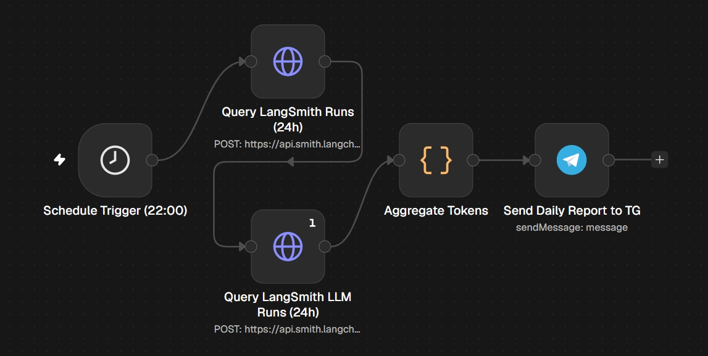

# LangSmith Daily Usage Report

Automated AI usage and cost monitoring with **LangSmith, n8n, and Telegram**.

Track token consumption, model usage, workflow activity, and estimated costs with automated daily reports delivered directly to Telegram.

## 📸 Workflow Overview



## 📌 About the Project

When working with multiple AI-powered workflows, it is easy to lose track of token consumption and API costs.

**LangSmith Daily Usage Report** automates usage monitoring by collecting execution data from the LangSmith API, processing it in n8n, and sending a summarized report to Telegram every evening.

The report provides a convenient overview of AI usage over the previous 24 hours without having to open the LangSmith dashboard every day.

## ✨ Key Features

- **Automated daily reports** - scheduled execution every day at 22:00.
- **Token consumption tracking** - total, prompt, and completion tokens.
- **Model usage breakdown** - token consumption grouped by AI model.
- **Workflow usage breakdown** - execution counts, tokens, and costs grouped by root run name.
- **Cost monitoring** - estimated usage costs in USD.
- **Telegram notifications** - readable HTML-formatted reports.
- **Pagination support** - retrieves data across multiple pages of LangSmith API results.
- **Rolling 24-hour reporting** - covers the previous 24 hours rather than a calendar day.

## 🏗️ Architecture

The solution consists of two separate parts:

1. **Tracing integration** - sends AI execution traces from supported applications to LangSmith.
2. **Reporting workflow** - retrieves usage data from LangSmith, aggregates statistics, and delivers the report to Telegram.

### Execution Flow

The n8n workflow runs sequentially:

```text
Schedule Trigger (22:00)
          |
          v
Query LangSmith Runs (24h)
          |
          v
Query LangSmith LLM Runs (24h)
          |
          v
    Aggregate Tokens
       (JavaScript)
          |
          v
 Send Daily Report to TG
```

### Workflow Components

| Component | Responsibility |
|---|---|
| Schedule Trigger (22:00) | Starts the workflow every day at 22:00 (Europe/Kyiv). |
| Query LangSmith Runs (24h) | Retrieves root runs and their token and cost information. |
| Query LangSmith LLM Runs (24h) | Retrieves individual LLM runs for model-level statistics. |
| Aggregate Tokens | Processes and groups the collected data using JavaScript. |
| Send Daily Report to TG | Sends the formatted report to Telegram. |

## ⚙️ How It Works

### 1. Schedule Trigger

The workflow starts automatically every day at 22:00.

- Timezone: `Europe/Kyiv`
- Cron expression:

```cron
0 22 * * *
```

### 2. Retrieve Root Runs

The first HTTP Request node sends a POST request to the LangSmith API:

```text
POST https://api.smith.langchain.com/api/v1/runs/query
```

It retrieves root runs for the configured LangSmith project.

The query includes:

- Run ID and name
- Run type
- Start time
- Prompt, completion, and total tokens
- Prompt, completion, and total costs
- Session ID

The reporting period is calculated dynamically:

```javascript
$now.minus({ hours: 24 }).toUTC().toISO()
```

Pagination is enabled to retrieve results across multiple pages.

### 3. Retrieve LLM Runs

After the root runs request completes, the second HTTP Request node queries LLM runs using the same API endpoint.

It retrieves additional information required for model-level statistics:

- Token consumption
- Model metadata
- Provider metadata
- Invocation parameters
- Cost information

This request also supports pagination.

**Important:** Both API requests execute sequentially, not in parallel.

### 4. Aggregate Usage Data

The JavaScript Code node processes the results from both HTTP requests.

It accesses root run data directly from the first request node:

```javascript
$('Query LangSmith Runs (24h)').all()
```

LLM run data is received through the current node input:

```javascript
$input.all()
```

No Merge node is required.

The aggregation logic performs three main tasks.

**Root run statistics**

- Groups runs by workflow or chain name.
- Calculates execution counts.
- Aggregates prompt, completion, and total tokens.
- Calculates costs.
- Builds overall usage statistics.

**LLM model statistics**

- Identifies models using available metadata and invocation parameters.
- Groups LLM runs by model.
- Collects provider information when available.
- Aggregates token consumption and costs.

**Report formatting**

- Sorts workflows and models by token consumption.
- Displays the top 10 workflows.
- Displays the top 5 models.
- Groups remaining entries into summary categories.
- Formats token counts into readable K/M values.
- Formats costs in USD.
- Escapes HTML characters for Telegram message formatting.

### 5. Send Telegram Report

The final Telegram node sends the generated report using HTML formatting.

The report includes:

- Total estimated cost.
- Total token consumption.
- Number of root runs.
- Prompt and completion tokens.
- Workflow-level statistics.
- Model-level statistics.

## 📊 Report Preview

The report is generated dynamically from LangSmith data.

```text
📊 Daily AI Usage Report

Period: Last 24 hours

💰 Total Cost: $X.XXXX
🔢 Total Tokens: XX,XXX
🚀 Root Runs: XX

📥 Prompt Tokens: XX,XXX
📤 Completion Tokens: XX,XXX

🔗 Workflows
- Workflow A: XX,XXX tokens
- Workflow B: XX,XXX tokens

🤖 Models
- Model A: XX,XXX tokens
- Model B: XX,XXX tokens
```

## 🔌 Tracing Integration

The reporting workflow relies on execution data already collected in LangSmith.

To monitor applications such as self-hosted n8n and Langflow, configure their supported LangSmith tracing integrations.

Typical LangSmith environment variables include:

```env
LANGCHAIN_TRACING_V2=true
LANGCHAIN_API_KEY=your_langsmith_api_key
LANGCHAIN_PROJECT=your_project_name
LANGCHAIN_ENDPOINT=https://api.smith.langchain.com
```

The exact configuration depends on the application and its LangSmith integration.

For Langflow, use its supported LangSmith tracing configuration. Refer to the official documentation for the environment variables and startup options applicable to your installed version.

**Note:** Tracing configuration and the daily reporting workflow are separate. The reporting workflow reads data from LangSmith through its API; it does not configure tracing for other applications.

## 🛠️ Technology Stack

| Technology | Purpose |
|---|---|
| n8n | Workflow automation and scheduling |
| LangSmith | LLM tracing and usage data |
| LangSmith API | Retrieving run and token information |
| JavaScript | Data aggregation and report generation |
| Telegram | Daily notifications |

## 🔐 Configuration

Before activating the workflow, configure the following:

| Parameter | Description |
|---|---|
| LangSmith API key | Authenticates API requests. |
| LangSmith project/session ID | Identifies the project whose runs should be monitored. |
| Telegram credentials | Authorizes Telegram message delivery. |
| Telegram chat ID | Specifies the destination chat. |
| Schedule timezone | Set to `Europe/Kyiv`. |

### Security Recommendations

- Store API keys in n8n Credentials or protected environment variables.
- Never commit API keys, Telegram bot tokens, or other secrets to GitHub.
- Remove sensitive credentials from exported workflow JSON files before publishing.
- Consider using a dedicated LangSmith project for a specific group of workflows.

## ⚠️ Limitations

- The report covers a rolling 24-hour period, not a calendar day.
- Costs are based on the cost information returned by LangSmith. Actual provider billing may differ.
- LangSmith usage statistics do not directly represent the remaining balance of an AI provider account.
- Model-level statistics depend on the availability of model and provider metadata in LLM runs.
- Root run statistics and LLM run statistics represent different execution levels and should not be added together.

## 📁 Repository Structure

```text
langsmith-daily-usage-report/
│
├── README.md
│
├── doc/
│   └── workflow.jpg
│
└── workflow/
    └── LangSmith_Daily_Tokens_Report_to_TG.json
```

The repository contains:

- `README.md` - project documentation.
- `doc/workflow.jpg` - n8n workflow architecture screenshot.
- `workflow/LangSmith_Daily_Tokens_Report_to_TG.json` - exported n8n workflow, ready for import into another n8n instance.

## 🚀 Import Workflow

1. Download `LangSmith_Daily_Tokens_Report_to_TG.json` from the `workflow/` directory.
2. Open your n8n instance.
3. Create a new workflow or open the workflow editor.
4. Select **Import from File**.
5. Select the downloaded JSON file.
6. Configure your LangSmith API access and Telegram credentials.
7. Verify the project/session ID and Telegram chat ID.
8. Activate the workflow.

Make sure all credentials and configuration parameters are updated before activation.

## 🎯 Project Goal

The goal is simple: make AI usage and cost monitoring accessible without manually checking dashboards and billing pages.

A small automated workflow provides a daily overview of token consumption, model activity, and estimated costs - directly in Telegram.

**Know what your AI workflows consume before the bill arrives.**
